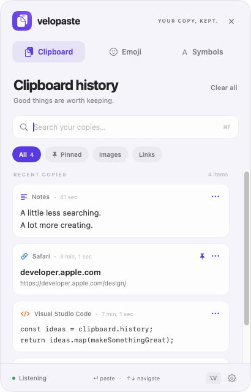
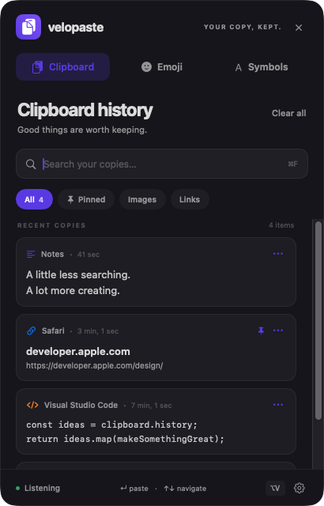

# Velopaste

**Your copy, kept.** A native, open-source clipboard history for macOS, inspired by the Windows Win+V workflow.

Open with **⌥V**. Search your copies. Press Return to use one. Pin the things you reach for every day.

<p>
  
  
</p>

## What it does

- Compact floating panel and a quiet menu bar icon; no Dock clutter.
- Text, links, images, and preservation of accompanying RTF/HTML clipboard formats.
- Instant search by content or source app; All, Pinned, Images, and Links filters.
- Pins, deduplication, per-item deletion, full previews, and Clear all that keeps pins.
- Keyboard navigation, quick item shortcuts, and optional direct pasting into the previous app.
- Searchable emoji and symbol pickers, including currency and Mac keyboard symbols.
- Light, dark, and system appearance; configurable shortcut, history size, and launch at login.
- Local AES-256-GCM encrypted history with the key in macOS Keychain.
- Pause/resume, excluded apps, and automatic skipping of marked confidential/transient clipboard entries.
- No dependencies, accounts, telemetry, network calls, or subscription. MIT licensed.

## Install on this Mac

Requires macOS 13 or later and Xcode or the Swift command-line toolchain. The build targets the current Mac's architecture.

```sh
./scripts/install.sh
```

This builds and ad-hoc signs `dist/Velopaste.app`, installs it in `~/Applications`, and opens it. You can also open the built app directly:

```sh
./scripts/build.sh
open dist/Velopaste.app
```

The app opens its panel on first launch and then lives in the menu bar. Copy something after launch to start your history. Existing clipboard contents are intentionally not imported on startup. If macOS asks for clipboard access, allow it to enable history capture.

For direct paste, open the gear icon → **Enable Accessibility**, then allow Velopaste in System Settings → Privacy & Security → Accessibility. Until permission is granted, choosing a copy places it on the clipboard; use ⌘V in your app. Rebuilding an ad-hoc signed app can require re-enabling Accessibility.

Right-click the menu bar icon for pause, settings, and quit. Open at login is opt-in.

## Keyboard

| Shortcut | Action |
| --- | --- |
| ⌥V | Open/close from anywhere (changeable to ⌘⇧V or ⌃⌥V) |
| ↑ / ↓ | Select a history item |
| Return | Paste selected item, or copy without Accessibility |
| Shift+Return / Shift+click | Use plain text |
| ⌘1 … ⌘9 | Use one of the first nine filtered items |
| ⌘F | Focus search |
| ⌘, | Settings from the clipboard panel |
| Esc | Close settings, or dismiss panel |

## Data and privacy

History is saved to `~/Library/Application Support/Velopaste/history.encrypted`. The encryption key is stored as the Keychain item with service `app.velopaste.history`; it is device-only and available when the Keychain is unlocked. The app directory uses permission `0700` and the history file `0600`. Preferences contain settings and excluded bundle IDs, not clipboard contents.

Turning off **Remember history after quitting** removes the saved history file and keeps the current session in memory. **Delete all history, including pins** removes all entries from the app; neither operation clears the system clipboard. Keychain failures fall back to an in-memory session with a visible message. Existing unreadable history is not silently overwritten at startup.

Velopaste honors the [NSPasteboard confidential/transient conventions](https://nspasteboard.org/) and excludes several password apps by default. Unmarked secrets can still be captured, especially from browser extensions. Add source apps to the exclusion list or pause history when needed. Source app attribution is best-effort; it uses the clipboard's source marker or the foreground app at capture time.

Polling runs every 500 ms. Items copied and replaced faster than that may be missed. The default capacity is 25 items, configurable to 250. Captured representations are limited to 4 MiB per entry and 32 MiB for the history payload. Oldest unpinned entries are evicted first. Pins survive capacity reductions; an all-pinned history can reject new copies when full.

## Windows comparison

The core history workflow follows [Microsoft's clipboard documentation](https://support.microsoft.com/en-us/windows/apps/using-the-clipboard): open a panel, reuse text/images, pin, delete, and clear unpinned history. The interface is an original native macOS design. It is not a pixel-identical Windows shell component and does not include Microsoft account sync, cloud clipboard, online GIF search, or file-copy history. The emoji/symbol catalog is curated rather than the complete Windows catalog. No Microsoft assets are included, and this project is unaffiliated with Microsoft.

## Development and verification

```sh
swift build
swift test
./scripts/build.sh
swift scripts/smoke-test.swift "$PWD/dist/Velopaste.app"
```

The 18 automated tests cover actual private NSPasteboard capture/restoration, RTF preservation, images, confidential markers, pause/resume, exclusions, history limits, pins, deduplication, filtering, and encrypted storage/tamper detection. Tests never touch your system clipboard or Keychain. The separate smoke test uses a temporary system clipboard fixture, an isolated in-memory app session, and restores the clipboard afterward; synthesized keystrokes require Accessibility for the invoking terminal or agent.

Deterministic previews use sample data, do not monitor the real clipboard, and do not open the vault:

```sh
dist/Velopaste.app/Contents/MacOS/Velopaste --preview --snapshot "$PWD/docs/clipboard-light.png"
dist/Velopaste.app/Contents/MacOS/Velopaste --preview --dark --snapshot "$PWD/docs/clipboard-dark.png"
dist/Velopaste.app/Contents/MacOS/Velopaste --preview --emoji --snapshot "$PWD/docs/emoji.png"
dist/Velopaste.app/Contents/MacOS/Velopaste --preview --settings --snapshot "$PWD/docs/settings.png"
```

Source is organized into the history model (`Clip.swift`), clipboard service (`ClipboardStore.swift`), encrypted persistence (`Vault.swift`), panel/views, and AppKit application/global shortcut integration. Open `Package.swift` in Xcode or use SwiftPM. The original app icon is generated by `scripts/make-icon.swift`.

This local build is ad-hoc signed, not Apple-notarized. Distribution to other Macs should use your own Developer ID signing and notarization. The repository is prepared for sharing; no remote repository is created automatically.

## Name and license

“Velopaste” had no exact matching clipboard app in the web, GitHub, and US Mac App Store checks performed on November 2, 2026. See [name-check evidence](docs/NAME-CHECK.md). These checks cannot guarantee worldwide uniqueness.

[MIT License](LICENSE). Contributions are welcome; see [CONTRIBUTING.md](CONTRIBUTING.md).
